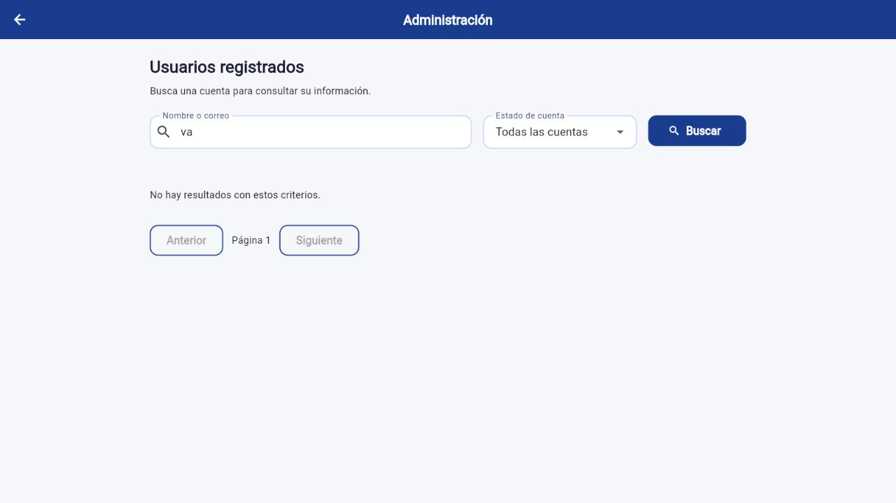
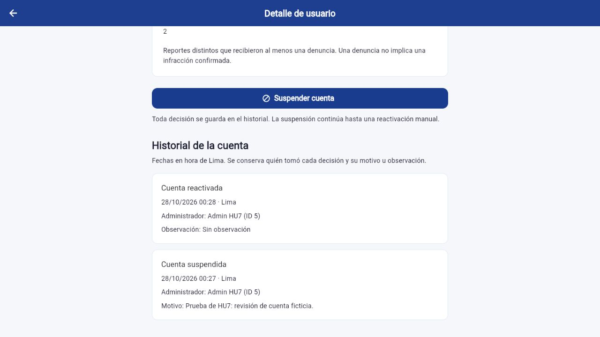
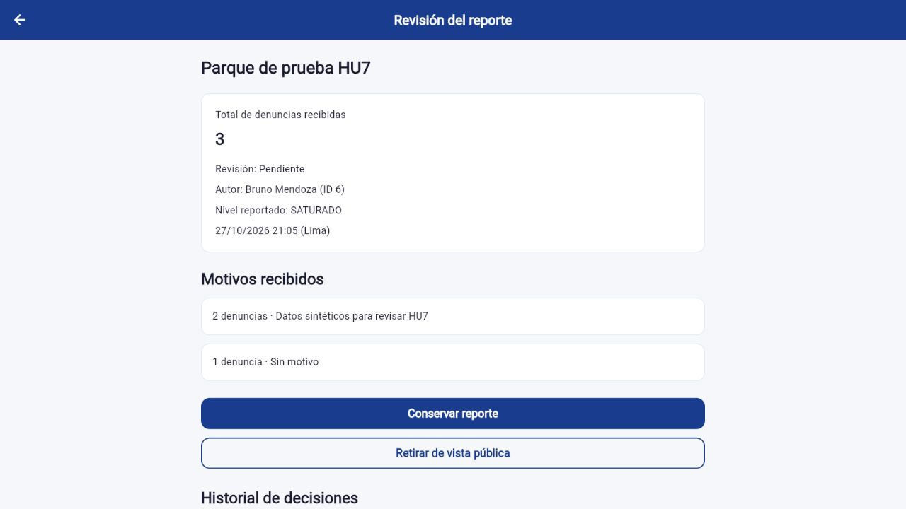
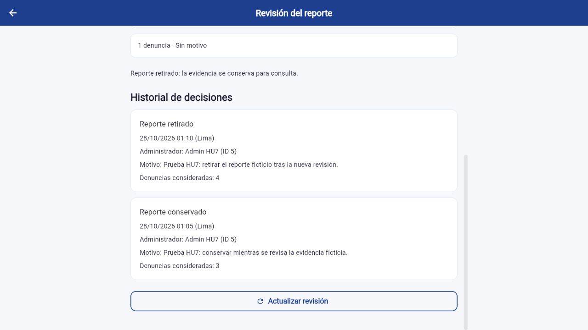

# HU7: recorrido Web y evidencia

Nicolás Kou / kowisprox, 28/10/2026. Candidato HU7 sobre frontend711384d/backend43964f7; el par final publicado se acredita en sus PR. No constituye merge ni aceptación por otro integrante. Contrato y matriz de historias en docs/CONTRATO_API y docs/REVISION_HU7 del backend compañero.

## Recorrido funcional

1. Perfil ADMIN → Administrar usuarios. Buscar `va` no devuelve coincidencias en los fixtures actuales; `BRU` devuelve Bruno. Nombre/correo y estado se combinan. Seleccionar abre detalle separado y volver conserva filtros.
2. Suspender una cuenta ciudadana exige motivo y confirmación. Reactivar permite observación vacía y conserva ambos eventos bajo las acciones. Cada evento muestra administrador, fecha Lima y motivo/observación. Sesión anterior permanece inválida; nuevo login funciona tras reactivar.
3. Perfil ADMIN → Revisar reportes denunciados. Lista por estado y enlace desde el usuario/autor. El detalle presenta primero el total y luego motivos agrupados con cantidades, incluido Sin motivo. No muestra identidades de denunciantes.
4. Conservar guarda decisión sin ocultar. Una nueva denuncia vuelve a Pendiente conservando el evento anterior. Retirar exige motivo/confirmación; conserva evidencia e historial, cuenta y puntos, excluyendo consultas/cálculos públicos incluso históricos. Retirados son de solo lectura.
5. Filtrar Retirados → Aplicar filtro → detalle → Historial de decisiones. El autor abre su historial privado y consulta evidencia; un tercero no accede al reporte retirado.

En envío pendiente se bloquean salida y doble acción. Un409 o respuesta incierta requiere actualizar; no hay reenvío automático. Cambiar sesión cierra confirmación y descarta respuestas antiguas. Tema, dependencias y locks se conservan.

## Pruebas

Flutter3.41.9/Dart3.11.5: análisis sin problemas;612 aprobadas, cero fallidas y las mismas dos opt-in anteriores omitidas; Web release compilada en34,1s para API3067. Widgets de administración cubren360/390/1440 y texto1×/2×. Backend198/198 y18 bloques SQL/HTTP reales en su única base HU7 aislada; no se atribuyen a Android ni a CI de GitHub.

Recorrido IAB real: Web5567/API3067/PostgreSQL5447. Solo cuentas ficticias, sin correo real. Capturas de esta versión:

## Límites para la revisión

El tercer criterio heredado de HU7.3 pide un aviso explícito de suspensión al iniciar sesión. El backend conserva el mensaje uniforme de autenticación acordado anteriormente; el bloqueo sí está comprobado, pero esa redacción literal requiere alineación con equipo/JP. No se cierra la historia automáticamente.

Android, lector de pantalla, revisión ajena e integración del par siguen pendientes. La visualización de Sites es el boceto previo. No se añade HU8/Favoritos, despliegue remoto ni persistencia del JWT. El cliente requiere el backend HU7 con migraciones008/009 aplicadas; una compilación anterior no prueba estas pantallas.
